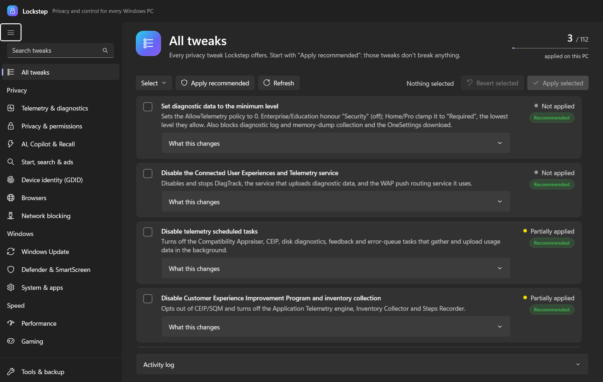
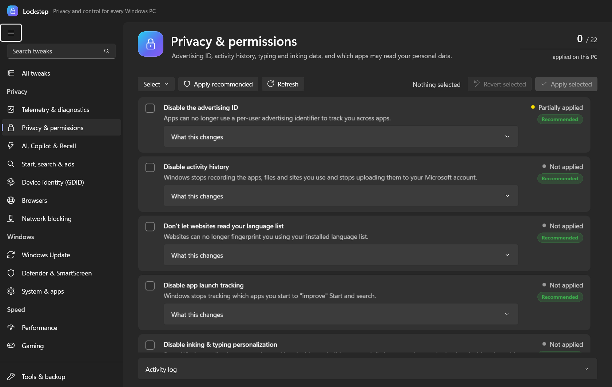
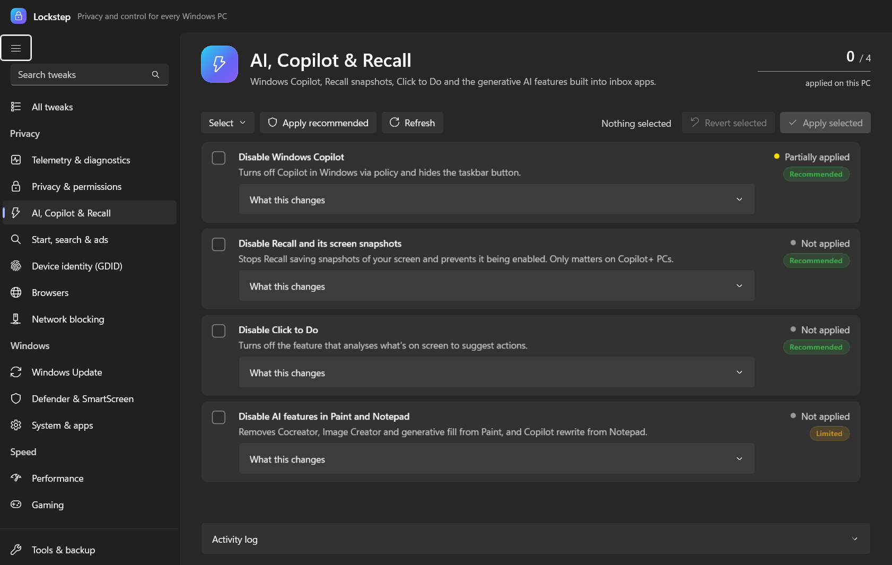
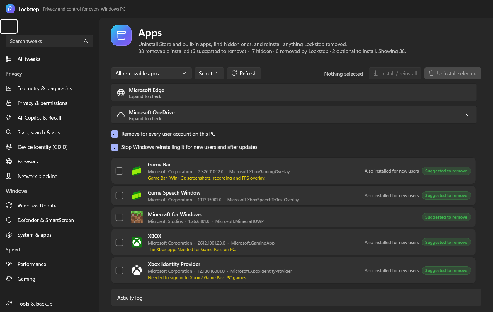
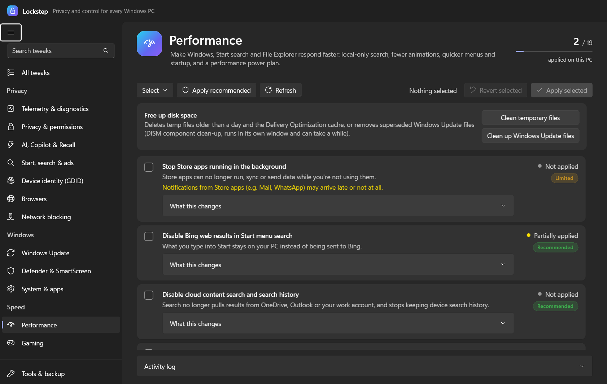
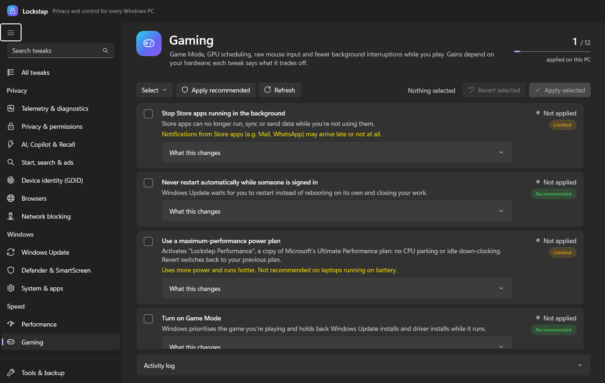
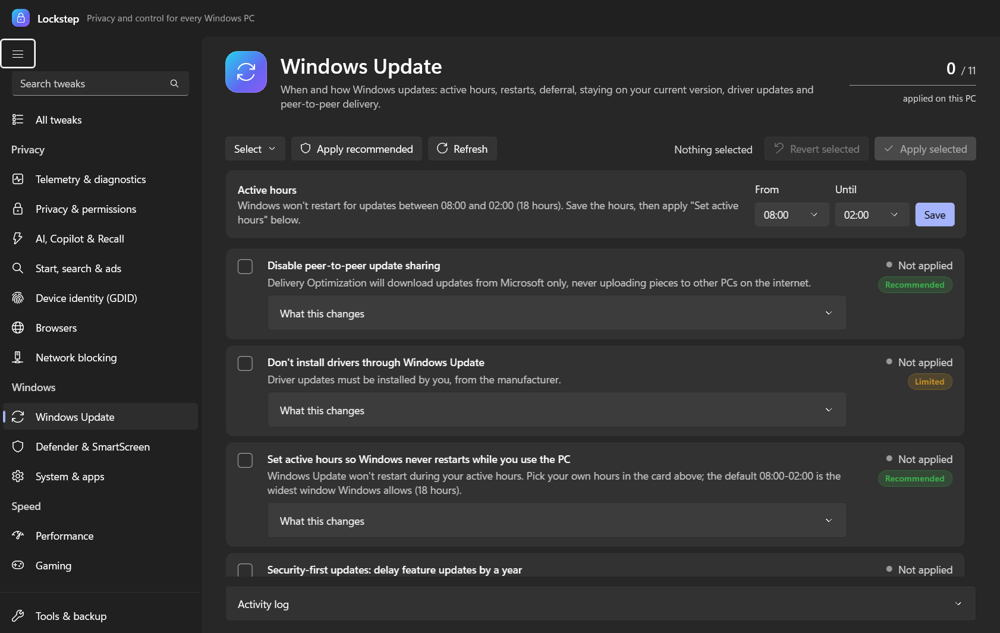
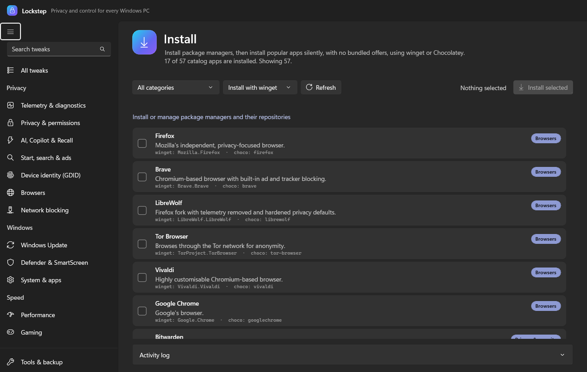
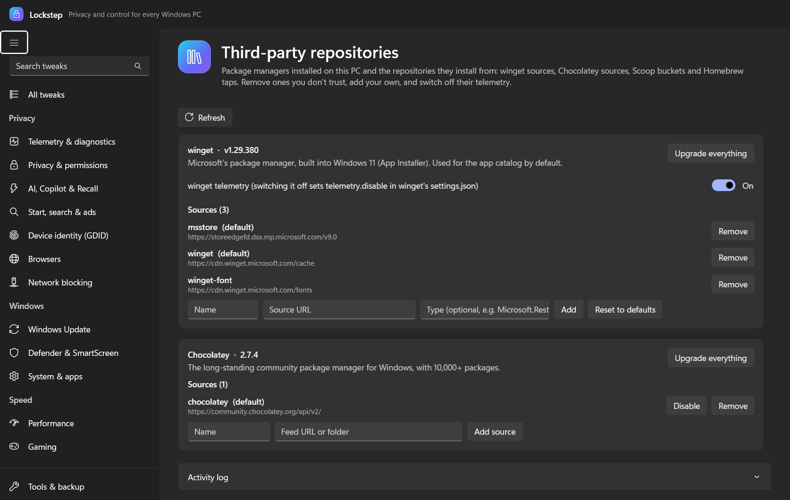
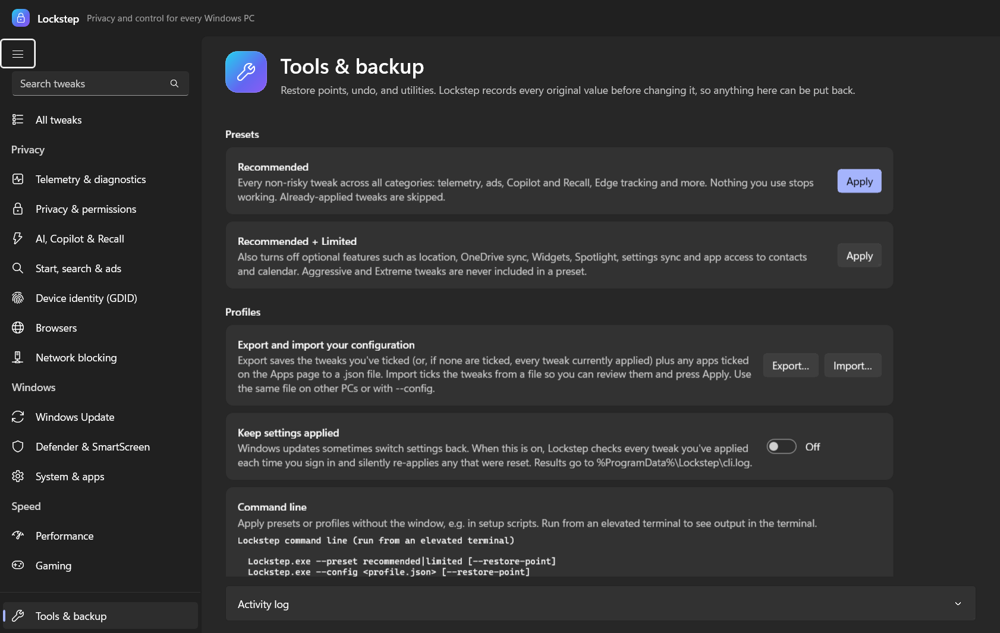

<p align="center">
  
</p>

<p align="center">
  
  
  
  
  
  <a href="LICENSE"></a>
</p>

<p align="center">
  <b>One native Windows app to switch off telemetry, ads and AI data collection, remove bloatware, and keep every Windows PC you manage set up the same way, without breaking anything you can't undo.</b>
</p>

<p align="center">
  <a href="#-why-lockstep-exists">Why</a> •
  <a href="#-screenshots">Screenshots</a> •
  <a href="#-features">Features</a> •
  <a href="#-getting-started">Getting started</a> •
  <a href="#%EF%B8%8F-command-line">Command line</a> •
  <a href="ROADMAP.md">Roadmap</a>
</p>

---

## 🤔 Why Lockstep exists

Out of the box, Windows reports far more than most people realise: diagnostic data, app usage, typing and inking, location, a permanent device ID, and what you type into Start search. It also fills Start, the lock screen and Settings with ads, quietly installs sponsored apps, and keeps adding AI features such as Copilot and Recall that watch what you do.

Turning all of that off by hand means hundreds of settings spread across the registry, Group Policy, services, scheduled tasks, the firewall and the hosts file. Updates sometimes turn them back on, too. Doing it again on every PC you look after is worse.

Lockstep exists to make that **one tidy, transparent, reversible job**:

- 🛡️ **Fix Windows' privacy problems:** telemetry, tracking, ads, Copilot/Recall, Bing in Start, the Global Device ID (GDID) and more.
- 🖥️ **Manage your Windows installs:** export a profile, then apply the same setup to any PC from the app or a script, and keep it applied after updates.
- 🔍 **No black box:** every tweak shows exactly what it changes, its risk level, and whether it's applied right now.
- ↩️ **Nothing is a one-way trip:** original values are backed up before anything changes, and every tweak can be reverted.

It's in the spirit of O&O ShutUp10++, O&O AppBuster and Chris Titus' WinUtil, in one native Windows 11-style app.

## 📸 Screenshots

<table>
  <tr>
    <td width="50%"><br><sub><b>🧾 All tweaks:</b> risk level, live status and exactly what each one changes</sub></td>
    <td width="50%"><br><sub><b>🔒 Privacy & permissions:</b> advertising ID, activity history, app access</sub></td>
  </tr>
  <tr>
    <td><br><sub><b>🤖 AI, Copilot & Recall:</b> turn off the features that watch your screen</sub></td>
    <td><br><sub><b>🧹 Apps:</b> remove bloatware, Edge and OneDrive safely, and reinstall anything later</sub></td>
  </tr>
  <tr>
    <td><br><sub><b>⚡ Performance:</b> faster search, Explorer and startup, plus disk clean-up</sub></td>
    <td><br><sub><b>🎮 Gaming:</b> Game Mode, GPU scheduling, raw mouse input and more</sub></td>
  </tr>
  <tr>
    <td><br><sub><b>🔄 Windows Update:</b> active hours, no surprise restarts, security-first updates</sub></td>
    <td><br><sub><b>📦 Install:</b> 58 popular apps, installed silently with winget or Chocolatey</sub></td>
  </tr>
  <tr>
    <td><br><sub><b>🗂️ Third-party repositories:</b> winget, Chocolatey, Scoop and Homebrew sources</sub></td>
    <td><br><sub><b>🧰 Tools & backup:</b> presets, profiles, restore points, repairs and Windows features</sub></td>
  </tr>
</table>

## ✨ Features

### 🛡️ Privacy tweaks: 112 of them, in 12 sections

| | Section | Highlights |
|---|---|---|
| 📊 | **Telemetry & diagnostics** | Minimum diagnostic data, DiagTrack off, telemetry tasks off, error reporting, firewall blocks for telemetry programs |
| 🔒 | **Privacy & permissions** | Advertising ID, activity history, inking & typing, online speech, location, sensors, app access to camera, mic, files and more |
| 🤖 | **AI, Copilot & Recall** | Copilot, Recall snapshots, Click to Do, AI in Paint and Notepad |
| 🔍 | **Start, search & ads** | No Bing in Start, no suggested apps, no lock-screen ads, Widgets and Spotlight off |
| 🌐 | **Browsers** | Edge, Brave, Firefox and Chrome telemetry, shopping, AI and background features |
| 🔄 | **Windows Update** | Active hours, no automatic restarts, security-first deferral, stay on your version, P2P delivery off |
| 🦠 | **Defender & SmartScreen** | What Defender, SmartScreen and MRT report back (with the protection trade-offs spelled out) |
| 🚫 | **Network blocking** | Hosts-file blocks for telemetry, ads or *all* Microsoft services, DNS-over-HTTPS, DNS provider picker, IPv6 tunnels off, NTP pool |
| ⚡ | **Performance** | Local-only fast search, Explorer opens to This PC, no startup delay, power plan, hibernation, disk clean-up |
| 🎮 | **Gaming** | Game Mode, GPU scheduling, raw mouse input, game priority, power throttling off |
| 🪪 | **Device identity (GDID)** | See and reduce reporting of Windows' permanent Global Device ID, or reset the stored one |
| ⚙️ | **System & apps** | OneDrive sync, notifications and overlays, Remote Assistance, WPBT, Phone Link, device metadata |

Every tweak has a risk level, a plain-English description, and an expandable **"What this changes"** list of the exact registry values, services, tasks, firewall rules and domains it touches.

### 🚦 Risk levels

| Level | What it means |
|---|---|
| 🟢 **Recommended** | Nothing you use stops working. Safe for everyone. **Apply recommended** does all of these in one click. |
| 🟡 **Limited** | Turns off a feature some people use (OneDrive sync, location, Widgets…). |
| 🔴 **Aggressive** | Breaks or weakens something noticeable (camera access, SmartScreen, automatic updates…). |
| 🟣 **Extreme** | Cuts Windows off from Microsoft services: Update, Store, account sign-in, OneDrive, Bing, Copilot. |

### 🧹 Apps

- **Remove bloatware:** about 70 known promotional apps are pre-marked, and anything Windows needs is locked.
- **Hidden apps:** apps installed only for other accounts, or staged for new users.
- **Previously removed:** reinstall anything Lockstep uninstalled, or undo all of it at once.
- **Optional Windows apps:** Calculator, Photos, Terminal, HEIF/AV1/WebP codecs and more.
- **Microsoft Edge:** fully uninstalled with Edge's own uninstaller, **keeping WebView2** so other apps don't break. It refuses to run without another browser installed.
- **OneDrive:** uninstall or reinstall, keeping your files.
- **App permissions:** every app that asked for your camera, mic, location, contacts… when it last used them, and a per-app allow/deny switch.

### 📦 Install & repositories

- **Install:** a catalog of 58 popular apps (browsers, privacy tools, dev tools, media, gaming, office), installed silently with **winget** or **Chocolatey**, with no bundled offers.
- **Third-party repositories:** install **winget**, **Chocolatey**, **Scoop** or **Homebrew** (inside WSL, since Homebrew only runs on macOS and Linux). Then manage their sources, buckets and taps, turn off winget telemetry and Homebrew analytics, and upgrade everything they installed.

### 🖥️ Managing Windows installs

- 💾 **Profiles:** export your tweaks (and apps to remove) to a `.json` file, then import it on another PC or apply it with `--config`.
- 🔁 **Keep settings applied:** an optional sign-in task that quietly re-applies anything a Windows update switched back.
- ⌨️ **Command line:** presets, profiles and single tweaks for setup scripts and unattended installs.
- 🧳 **Portable:** a single self-contained `.exe` you can carry on a USB stick.

### 🧰 Tools

Restore points, *Revert all*, repair tools (reset Windows Update, reset network, DISM + SFC, reinstall winget), Windows features (SMB1 off, WSL, Sandbox, Hyper-V, .NET 3.5…), 19 classic control-panel shortcuts, and a hosts-file viewer.

## 🛟 Safety first

> [!IMPORTANT]
> Before Aggressive or Extreme tweaks, uninstalling apps or Edge, or disabling services, **create a restore point and back up your files.** Lockstep offers a restore point before every bigger change, and shows a welcome screen with the same advice on first launch.

- 💾 The original value of every registry setting, service and scheduled task is saved to `%ProgramData%\Lockstep\backup.json` **before** it's first changed. Reverting restores that exact value.
- 🏷️ Hosts entries live in tagged `# >>> Lockstep [...]` blocks and firewall rules are named `Lockstep - Block ...`, so both come out cleanly. The untouched hosts file is kept as `hosts.lockstep.bak`.
- ↩️ **Tools & backup → Revert all** undoes everything Lockstep changed.
- 🔐 Tweaks that could lock you out refuse to apply. For example, blocking Microsoft-account sign-in won't run while you sign in with one.
- 👀 Installer scripts downloaded from the internet (Chocolatey, Scoop, Homebrew) always run in a visible window.

## 🚀 Getting started

**Requirements:** Windows 10 (19041+) or Windows 11, x64 or ARM64. Building needs the [.NET 10 SDK](https://dotnet.microsoft.com/download); Visual Studio isn't needed.

```powershell
# from a clone of this repository
dotnet build src\Lockstep\Lockstep.csproj -c Release
.\src\Lockstep\bin\Release\net10.0-windows10.0.22621.0\win-x64\Lockstep.exe
```

Lockstep asks for administrator rights when it starts (UAC). Then:

1. 👋 Read the welcome screen and **create a restore point**.
2. 🟢 Press **Apply recommended**. These tweaks don't break anything.
3. 🔍 Browse the sections and read the warning before applying anything Limited, Aggressive or Extreme.
4. 🔁 Optionally turn on **Keep settings applied** under Tools & backup.

<details>
<summary><b>📦 Other ways to build</b></summary>

Self-contained folder (no .NET install needed on the target PC):

```powershell
dotnet publish src\Lockstep\Lockstep.csproj -c Release -r win-x64 --self-contained -o publish
```

Portable single exe (about 90 MB, nothing else needed):

```powershell
dotnet publish src\Lockstep\Lockstep.csproj -c Release -r win-x64 -p:Portable=true -o portable
```

</details>

## ⌨️ Command line

Any argument runs Lockstep without a window, which is handy for setup scripts and managing several PCs:

```text
Lockstep.exe --preset recommended|limited [--restore-point]
Lockstep.exe --config <profile.json> [--restore-point]     (or just: Lockstep.exe profile.json)
Lockstep.exe --apply <id>[,<id>...] [--restore-point]
Lockstep.exe --revert <id>[,<id>...]
Lockstep.exe --revert-all
Lockstep.exe --list                                        tweak IDs, risk and status
Lockstep.exe --enforce                                     re-apply the "Keep settings applied" list
```

Exit codes: `0` success, `1` some changes failed, `2` bad arguments. Everything is logged to `%ProgramData%\Lockstep\cli.log`. Run it from an **elevated** terminal to see the output there too.

A profile is plain JSON:

```json
{
  "version": 1,
  "name": "My privacy setup",
  "tweaks": ["telemetry.level", "telemetry.service", "privacy.adid", "ai.recall"],
  "removeApps": ["Microsoft.BingNews", "Microsoft.BingWeather", "king.com.*"],
  "removeAppsForAllUsers": true,
  "deprovisionApps": true
}
```

## 🧪 Development

```powershell
dotnet test tests\Lockstep.Tests          # catalog, profile and active-hours tests
.\scripts\Verify-Catalog.ps1              # checks every winget / Store / Chocolatey ID still exists
```

The tests guard the tweak catalog: unique IDs, valid sections, well-formed registry paths, a warning on every Aggressive and Extreme tweak, and **no two tweaks writing the same setting** (sharing a tweak between sections goes through `AlsoIn` instead).

GitHub Actions ([`.github/workflows/build.yml`](.github/workflows/build.yml)) builds and tests every push. Pushing a tag such as `v1.0.0` publishes portable x64 and ARM64 exes, with SHA-256 checksums, to a GitHub release.

## 🛠️ Contributing a tweak

Add an entry to [`src/Lockstep/Core/TweakCatalog.cs`](src/Lockstep/Core/TweakCatalog.cs) with the action helpers:

| Helper | Changes |
|---|---|
| `Lm` / `Cu` / `LmStr` / `CuStr` | a registry value (HKLM / HKCU, DWORD / string) |
| `Svc` | a service's startup type |
| `Sched` | a scheduled task (disabled) |
| `Fw` | an outbound firewall block for a program |
| `Hosts` | a hosts-file block list |

Status detection, backup, revert, presets, profiles and the UI all come for free. Bloatware and protected-app lists are at the top of [`AppPackages.cs`](src/Lockstep/Core/AppPackages.cs).

To refresh the README screenshots, run `Lockstep.exe --screenshots docs\screenshots`. It opens each page, saves a PNG and closes, and skips the pages that show personal data (Device identity, App permissions).

## ⚠️ Good to know

- **Lockstep used to be called FuWindows.** On first start it moves your backups, settings and the *Keep settings applied* task over automatically, and it still recognises hosts blocks and firewall rules created under the old name.

- `AllowTelemetry = 0` is only honoured on Enterprise and Education; Home and Pro clamp it to "Required".
- Policies for deferring updates and staying on a version only work on Pro and above.
- Microsoft Defender may flag telemetry entries in the hosts file as `SettingsModifier:Win32/HostsFileHijack`. Choose **Allow on device** to keep them.
- Defender policy tweaks are ignored while Tamper Protection is on.
- Big feature updates can switch settings back on. **Keep settings applied** handles that, or re-open Lockstep and re-apply.
- Current-user tweaks apply to the account Lockstep runs as. If you elevate with a *different* admin account, they land in that account.

## 🗺️ Roadmap

One item is still pending: a **Windows 11 ISO builder** that creates cleaned-up install media (bloatware removed offline, local account, your Lockstep profile applied on first sign-in). See [ROADMAP.md](ROADMAP.md).

## 📜 License

Lockstep is free software, licensed under the [GNU General Public License v3.0](LICENSE). You may use, study, share and modify it. If you distribute a modified version, you must release its source code under the same license.

## ⚖️ Disclaimer

Lockstep changes system settings. It backs up what it changes and every tweak is reversible, but you use it at your own risk: create a restore point and keep backups. Lockstep is an independent project and is not affiliated with, endorsed by or sponsored by Microsoft. Windows, Microsoft Edge, OneDrive, Copilot and other product names are trademarks of their respective owners.
